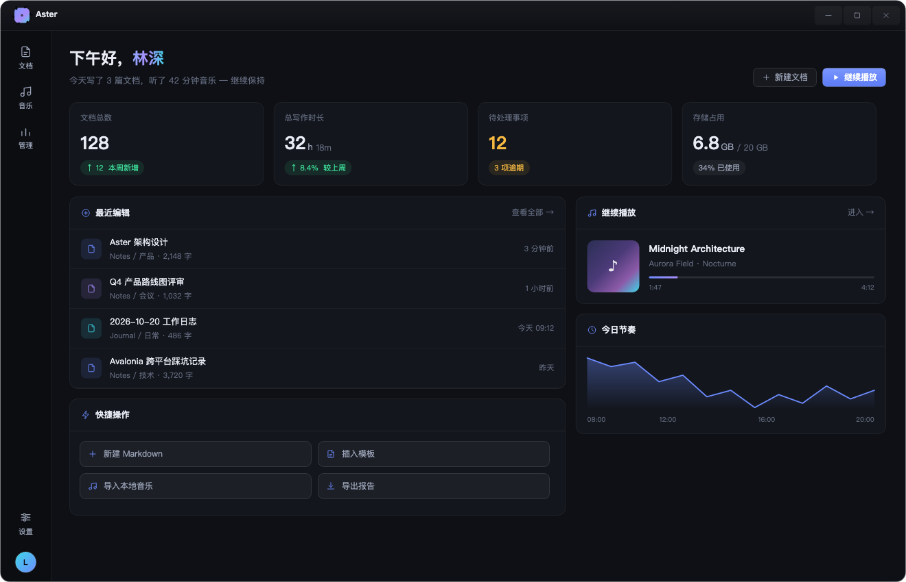
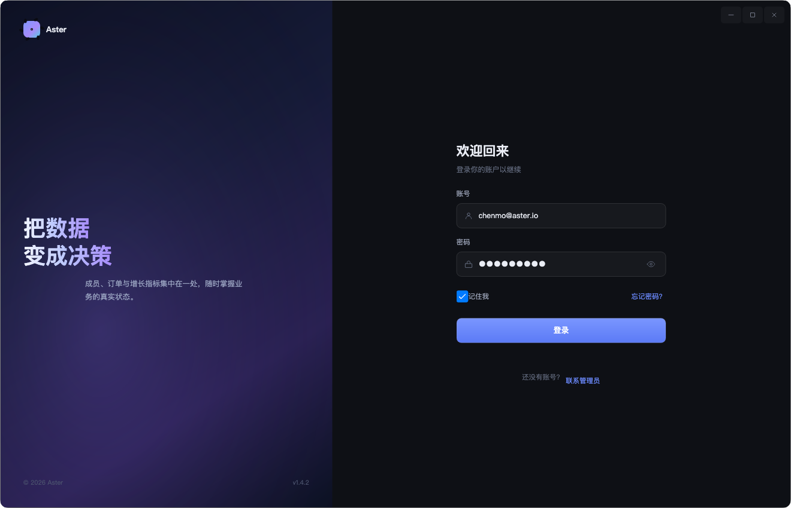
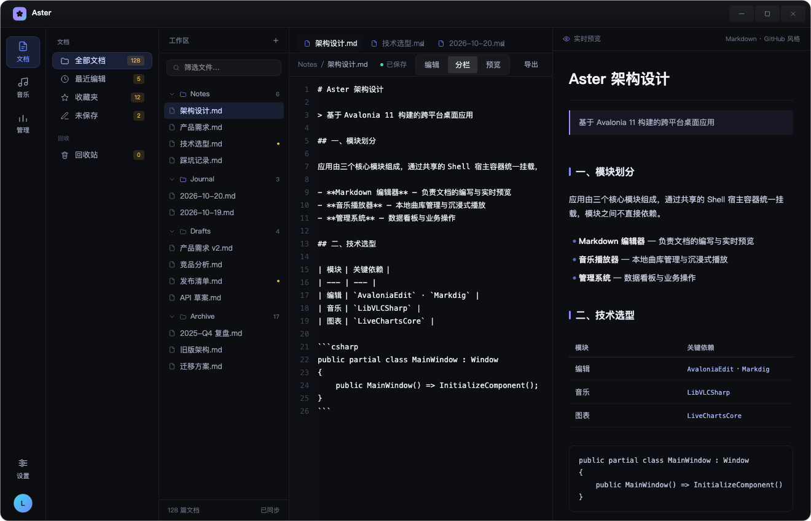
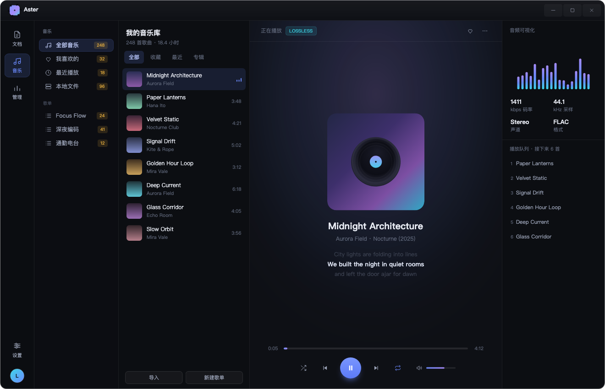
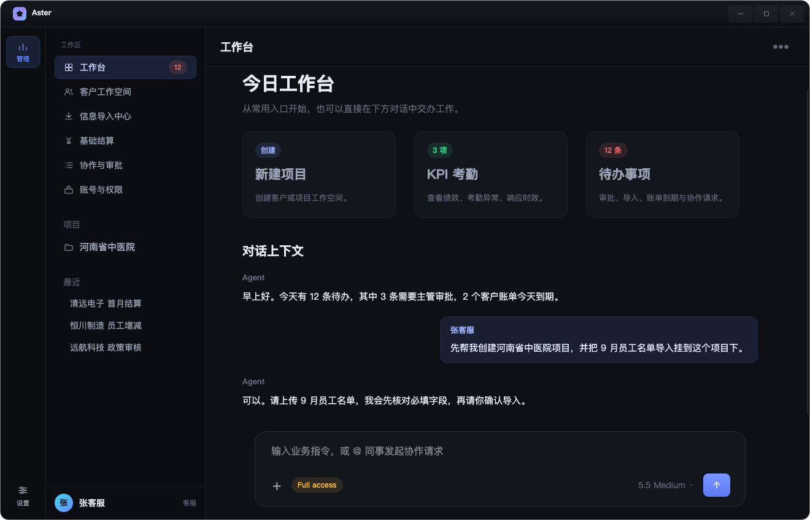
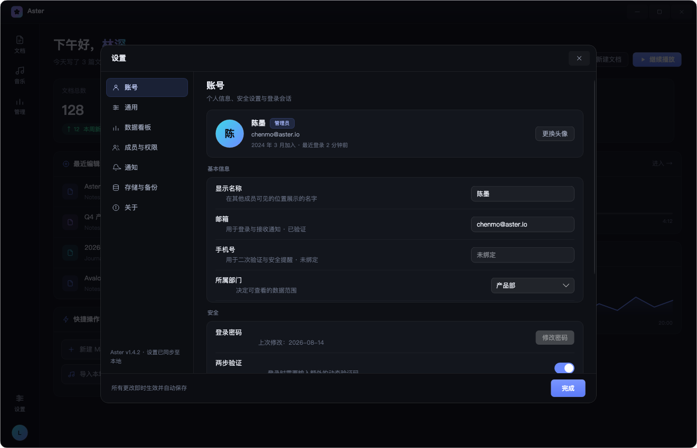
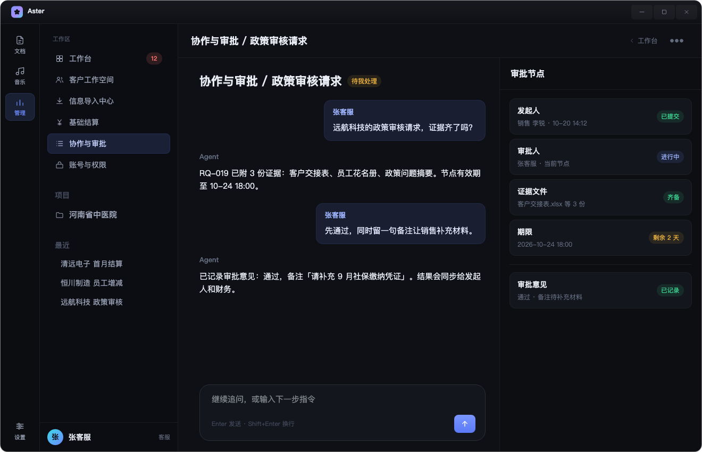

# Aster · Avalonia 桌面端

按 `aster-design.html` 设计稿 1:1 还原的跨平台桌面应用：深色玻璃质感、`#6C8BFF` 强调色、无边框圆角窗口，
包含工作台、Markdown 编辑器、音乐播放器、管理工作区与完整设置面板。

`Avalonia 11.3` · `.NET 8` · macOS / Windows / Linux

<p align="center">
  
</p>

## 功能一览

| 模块 | 能力 |
| --- | --- |
| **启动 / 登录** | 2 秒进度启动屏；账号密码登录、记住我、显示密码、忘记密码（两步弹窗）、联系管理员（两步弹窗） |
| **工作台** | 问候区、四张指标卡、最近编辑、快捷操作、继续播放、今日节奏面积图 |
| **文档** | 四级目录树（分组折叠 / 关键字搜索 / 按收藏·最近·未保存·回收站筛选）、多标签页、行号编辑器、Markdown 实时预览、编辑·分栏·预览三档视图 |
| **音乐** | 歌单（全部/收藏/最近/专辑）、旋转唱片舞台、歌词、可拖动进度与音量、随机·循环、音频可视化柱状图、播放队列 |
| **管理** | 工作区布局：今日工作台（3 个快捷入口卡 + Agent 对话 + 指令输入框）；按区域拆成 6 条流程页（新建项目 / KPI 考勤 / 待办事项 / 员工记录核查 / 结算任务进度 / 审批节点），均为「对话 + 右侧上下文抽屉」两栏；另有客户工作空间、信息导入中心、账号与权限列表页 |
| **设置** | 全屏模态，账号 / 通用 / 数据看板 / 成员与权限 / 通知 / 存储与备份 / 关于 七个分区 |

## 界面预览

<table>
  <tr>
    <td align="center" width="50%"><br><sub>登录 · 忘记密码 / 联系管理员两步弹窗</sub></td>
    <td align="center" width="50%"><br><sub>文档 · 目录树 + 行号编辑器 + 实时预览</sub></td>
  </tr>
  <tr>
    <td align="center" width="50%"><br><sub>音乐 · 唱片舞台 + 可视化 + 队列</sub></td>
    <td align="center" width="50%"><br><sub>管理 · 今日工作台 + 对话交办</sub></td>
  </tr>
</table>

<p align="center">
  
</p>

<p align="center">
  
</p>

## 快速开始

### 环境

- .NET 8 SDK（`dotnet --list-sdks` 能看到 `8.0.x`）
- 无需额外的运行时或原生库

如果 SDK 装在用户目录（如 `~/.dotnet`），先让终端能找到它：

```bash
export DOTNET_ROOT="$HOME/.dotnet"
export PATH="$DOTNET_ROOT:$PATH"      # 可写入 ~/.zshrc / ~/.bashrc 永久生效
```

### 运行

```bash
git clone git@github.com:CookingWine/Demo.git
cd Demo

# 方式一：一键脚本（macOS / Linux）
./Dome/run.sh

# 方式二：常规方式
cd Dome/Aster
dotnet run
```

只编译不运行：`dotnet build`，产物在 `Dome/Aster/bin/Debug/net8.0/`。

> **演示登录**：账号与密码默认为空，任意非空内容都能登录（无后端校验），登录后直接进入工作台。

> **关于 NuGet 源**：`Dome/Aster/NuGet.Config` 默认指向国内镜像 `https://nuget.azure.cn/v3/index.json`，
> 首次 `restore` 更快。需要官方源时删除该文件，或改成 `https://api.nuget.org/v3/index.json`。

### 发布

```bash
cd Dome/Aster
dotnet publish -c Release -r osx-arm64 --self-contained false
# Windows: -r win-x64 ；Linux: -r linux-x64
```

## 目录结构

```
.
├── README.md                    本文件
├── docs/screenshots/            界面截图（由程序真实渲染导出）
└── Dome/
    ├── Dome.sln
    ├── run.sh                   一键启动脚本
    └── Aster/
        ├── Program.cs           入口（AppBuilder + Inter 字体）
        ├── App.axaml(.cs)       Fluent 深色主题、资源与样式装配
        ├── Styles/
        │   ├── Theme.axaml      设计令牌 + 6 个自定义 ControlTheme
        │   └── Controls.axaml   按钮 / 输入框 / 导航 / 分段 / 开关 / 标签 / 滚动条样式
        ├── Controls/
        │   ├── Icon.cs          24×24 线性图标，颜色继承 Foreground
        │   ├── Icons.cs         图标 path 数据
        │   ├── Charts.cs        迷你折线、趋势图、环形图（DrawingContext 绘制）
        │   ├── Visuals.cs       五瓣 Logo、音频柱、旋转唱片、进度条、跳动指示器
        │   └── MarkdownPreview.cs  Markdown → 控件树渲染
        ├── ViewModels/          纯手写 MVVM（ObservableObject + RelayCommand）
        └── Views/               Shell / 工作台 / 文档 / 音乐 / 管理 / 设置 / 登录 / 启动屏
```

更细的模块说明见 [`Dome/Aster/README.md`](Dome/Aster/README.md)。

## 设计系统

| 令牌 | 值 |
| --- | --- |
| 窗口底 / 面板 | `#0E1015` / `#13161D` |
| 强调色 | `#6C8BFF`（辅色 `#A78BFA`、`#3DD6E8`） |
| 语义色 | 成功 `#3DDC97` · 警告 `#F5B942` · 危险 `#F8716E` |
| 文字层级 | `#E9ECF4` / `#9BA3B7` / `#626A7D` / `#434A5C` |
| 字号 | 页面标题 18 · 模块标题 15 · 正文 13 · 辅助 11.5 · 标签 10.5 |
| 圆角 | 6 / 8 / 11 / 14 / 20 |
| 字体 | Inter + 系统中文回退（PingFang SC / Microsoft YaHei） |

所有色值、圆角、字号集中在 `Dome/Aster/Styles/Theme.axaml`，改一处即可全局换肤。

## 技术说明

- **零第三方 UI 依赖**：未引入 AvaloniaEdit / Markdig / LibVLCSharp / LiveCharts。
  编辑器用 `TextBox` + 自绘行号（滚动偏移同步），预览把 Markdown 解析成控件树，
  图表与可视化全部走 `DrawingContext`，因此 `restore` 只需要 Avalonia 官方包。
- **MVVM**：手写 `ObservableObject` / `RelayCommand`，列表项自带命令与选中态，
  视图通过 `DataTemplate` 按 ViewModel 类型自动匹配。
- **无边框窗口**：`SystemDecorations=None` + 透明窗口，自绘标题栏负责拖拽、双击最大化与窗口按钮；
  内容区圆角 14 + 阴影由 `Border` 承担。
- **主题切换友好**：样式全部走 `DynamicResource`，替换资源字典即可做浅色主题。

## 已知限制

- 音乐模块为**交互演示**：进度随计时器推进、唱片旋转、柱状图跳动，未接入音频解码与真实播放。
- 管理页的 Agent 对话为本地模拟（内置 4 条回复话术，Enter 发送），未接大模型；各分区页为演示数据。
- 文档数据、成员、订单等均为内置演示数据，未接后端。
- Markdown 预览覆盖标题、引用、列表、表格、代码块与行内加粗/代码，暂不支持图片与嵌套列表。
